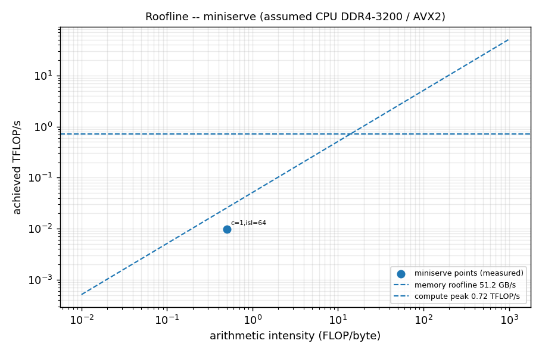
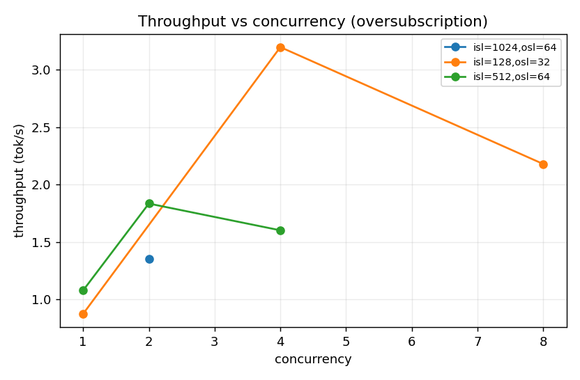
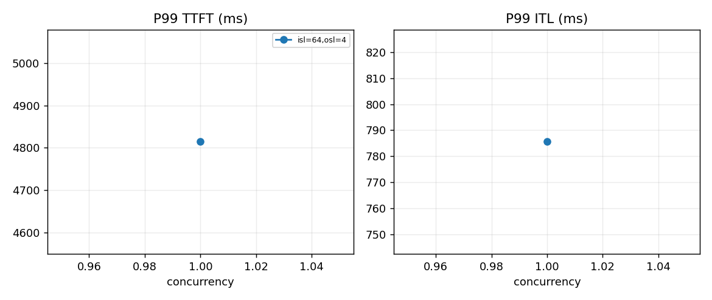
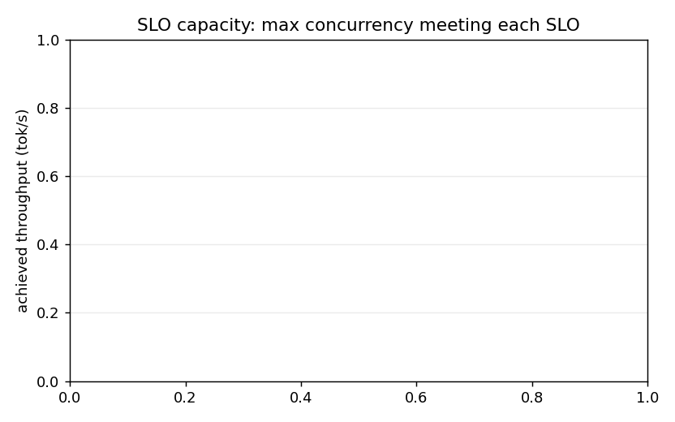
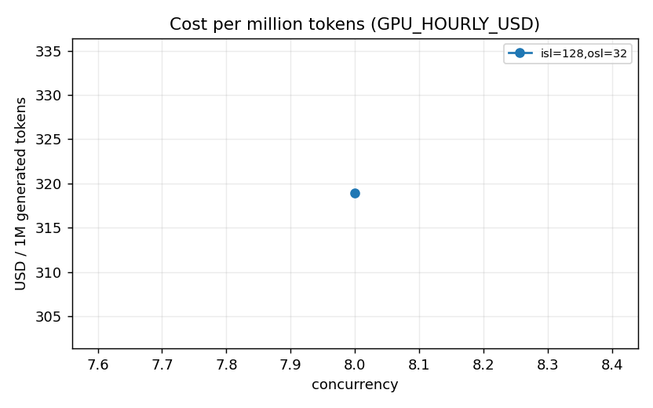
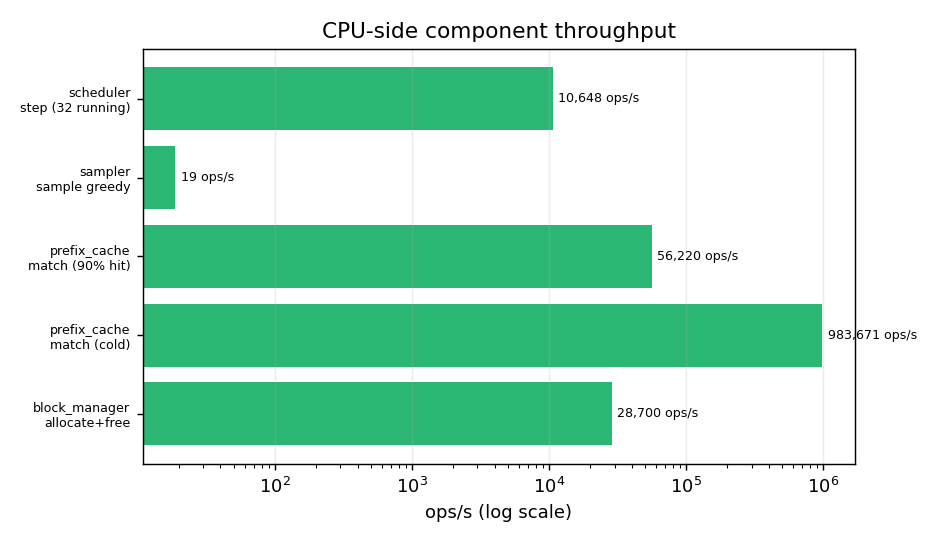

<div align="center">

# miniserve

### Continuous-Batching LLM Serving Engine — From First Principles

**Paged KV Cache → Radix Prefix Cache → Overlap Scheduler → Bucketed CUDA-Graph Decode → Grammar JSON → Empirical Benchmark Suite**

<br/>

[](https://github.com/ammmanism/miniserve/actions/workflows/ci.yml)
[](bench/regression_gate.py)
[](https://pytorch.org/)
[](https://fastapi.tiangolo.com/)
[](LICENSE)

<br/>

> **No wrappers. No hand-waving tutorials. No black boxes.**
> A from-scratch continuous-batching inference engine that proves *why* modern
> LLM runtimes are fast — and publishes where it loses, with committed CSVs.

</div>

---

## The Tenet: No CSV, No Claim

1. **Every performance number** in this README links to a committed CSV under
   [`bench/data/`](bench/data/).
2. **Correctness precedes performance**: greedy parity vs HuggingFace gates
   everything downstream.
3. **Gap accounting is public**: hardware, model, dtype, and `_TBD_` markers
   are stated instead of guessed.

> **Reference machine for every committed number:** 4-core Intel Tiger Lake,
> 19.7 GB RAM, **no GPU**, `Qwen/Qwen2.5-0.5B-Instruct` in **fp32**.
> These are CPU numbers. No CUDA number is claimed anywhere.
> See [`REPRODUCE.md`](REPRODUCE.md) and [`docs/GAP_ANALYSIS.md`](docs/GAP_ANALYSIS.md).

---

## Architecture

```
 HTTP / SSE ──► FastAPI server ──► Scheduler ──► OverlapEngine ──► ModelRunner
                (rate limit,       (priority,     (prefill/decode    (PagedAttention
                 dedup, grammar,    chunked        pipelining,        over a paged KV
                 backpressure,      prefill,       double buffers)    cache, CUDA-graph
                 /metrics)          SLO admit,                        decode buckets)
                                    preempt)
                     │                                                   │
                     └── Prometheus registry ◄── queue-wait ─────────────┘
                              ▲
                     bench/run_suite.py ──► bench/data/*.csv ──► bench/plot.py
```

| Module | What it owns |
|---|---|
| `miniserve/blocks.py` | Paged KV blocks, refcounts, copy-on-write forks, eviction |
| `miniserve/prefix_cache.py` | Radix trie over block tables (block-granular prefix reuse) |
| `miniserve/scheduler.py` | Priority + aging, chunked prefill, preemption, SLO admission |
| `miniserve/overlap.py` | Double-buffered, side-thread step pipelining |
| `miniserve/engine.py` | Thin composition of scheduler + overlap engine |
| `miniserve/attention.py` | PagedAttention: gather + masked softmax over pages |
| `miniserve/model_runner.py` | HF model hosting, paged KV injection, bucketed decode graphs |
| `miniserve/sampler.py` | Temperature/top-k/top-p + zero-dependency JSON grammar |
| `miniserve/server.py` | OpenAI-compatible API, dedup, rate limit, `/metrics` |
| `miniserve/metrics.py` | Dependency-free Prometheus text exposition |
| `bench/*` | Client, suite, plots, capacity planner, regression gate |

---

## Measured Performance (CPU reference; see CSVs)

### Roofline — where the engine lands



Decode is memory-bound at low batch (arithmetic intensity 0.50–0.97 FLOP/byte)
and the engine still reaches only **0.0043–0.0227 TFLOP/s**: **0.6–3.2% of the
assumed 0.72 TFLOP/s CPU compute peak** and far below the 51.2 GB/s memory
roofline. The distance is the missing kernel (`kernels/` is empty), not the
algorithm. Raw points: [`bench/data/roofline.csv`](bench/data/roofline.csv).

### Sweep results

| concurrency | isl | osl | TTFT p50 | TTFT p99 | ITL p50 | ITL p99 | tok/s | source |
|---:|---:|---:|---:|---:|---:|---:|---:|---|
| 1 | 128 | 32 | 8 270 ms | 8 270 ms | 833 ms | 1 509 ms | 0.874 | `all_results.csv` |
| 1 | 512 | 64 | 28 844 ms | 28 844 ms | 409 ms | 1 075 ms | 1.078 | `all_results.csv` |
| 2 | 512 | 64 | 19 718 ms | 35 035 ms | 422 ms | 3 554 ms | 1.834 | `all_results.csv` |
| 4 | 512 | 64 | 71 659 ms | 89 553 ms | 997 ms | 2 393 ms | 1.601 | `all_results.csv` |
| 2 | 1024 | 64 | 38 746 ms | 72 788 ms | 313 ms | 770 ms | 1.354 | `all_results.csv` |
| 4 | 128 | 32 | 11 574 ms | 15 051 ms | 764 ms | 1 267 ms | 3.195 | `all_results.csv` |
| 8 | 128 | 32 | 33 085 ms | 56 082 ms | 1 096 ms | 14 919 ms | 2.178 | `all_results.csv` |

Throughput is **not monotonic** in concurrency (c=2: 1.83, c=4: 1.60 tok/s):
four rows on four cores thrash. That is the measurement, not a model.




### SLO capacity — and the honest zero



| SLO (p99 TTFT / p99 ITL) | workload | max concurrency | tok/s |
|---|---|---:|---:|
| 500 ms / 50 ms | isl=512, osl=128 | **0** | 0 |
| 40 000 ms / 4 000 ms | isl=512, osl=64 | 2 | 1.834 |
| 20 000 ms / 2 000 ms | isl=128, osl=32 | 4 | 3.195 |

A production-shaped SLO admits **zero** requests on this hardware. The planner
returns `0`, not a plausible-looking number. Details:
[`docs/CAPACITY.md`](docs/CAPACITY.md), data:
[`bench/data/slo_capacity.csv`](bench/data/slo_capacity.csv).

### Cost per million tokens

`GPU_HOURLY_USD` is applied to every row. One committed row is priced at
**2.50 USD/h** (a hypothetical GPU rate, used to exercise the pipeline):

```
c=8, isl=128, osl=32 -> 2.178 tok/s -> 318.89 USD per 1M generated tokens
```

On CPU that dollar figure is not a market price — it exists to prove the
column's arithmetic (`device=cpu`, `gpu_hourly_usd=2.5` are in the row).
Data: [`bench/data/all_results.csv`](bench/data/all_results.csv).



### CPU-side microbenchmarks



| component | op | throughput |
|---|---|---:|
| block_manager | allocate+free | 28 700 ops/s (34.8 µs) |
| prefix_cache | match, cold | 983 671 ops/s (1.02 µs) |
| prefix_cache | match, 90% hit | 56 220 ops/s (17.8 µs) |
| sampler | greedy, 151 936 logits | **18.8 ops/s (53 ms)** |
| scheduler | step, 32 running | 10 648 ops/s (93.9 µs) |

The Python greedy sampler is the visible CPU-side gap (53 ms/token). Data:
[`bench/data/microbench.csv`](bench/data/microbench.csv).

---

## Gap Table vs Industry Engines

| Dimension | miniserve (measured) | vLLM | SGLang | Evidence |
|:---|:---|:---:|:---:|:---|
| Greedy parity vs HF | CI smoke 8/8; 200-prompt gate via `pytest tests/test_parity.py` | reference | reference | `tests/test_parity.py` |
| Paged attention | PyTorch paged path | C++/CUDA | Triton/FlashInfer | `miniserve/attention.py` |
| Triton split-K decode kernel | shipped, **CUDA launch unverified here** | yes | yes | `kernels/paged_attn_triton.py` |
| **FP8 GEMM / tensor-core matmul** | **not shipped** | yes | yes | `docs/GAP_ANALYSIS.md` Gap 2 |
| Continuous batching + chunked prefill | yes (static chunk size) | yes (adaptive) | yes (adaptive) | `miniserve/scheduler.py` |
| Prefix cache | radix, **block-granular** | hash/block | **token-granular** | 30-token prefix reuses 16 → `prefix_granularity.csv` |
| CUDA-graph decode | bucketed, **CPU fallback measured only** | native | native | `cuda_graph_tradeoff.csv` (0.72–1.39x = noise) |
| JSON grammar | zero-dep compiler | Outlines/XGrammar | Outlines/XGrammar | `miniserve/sampler.py` |
| Request dedup | native async | router-level | router-level | `miniserve/server.py` |
| Prometheus metrics | counters/gauges/histograms | yes | yes | `miniserve/metrics.py`, `/metrics` |
| **Throughput @ c=4, isl=512** | **1.601 tok/s (CPU)** | `_TBD_` | `_TBD_` | `all_results.csv` |
| **P99 ITL @ c=4, isl=512** | **2 393 ms (CPU)** | `_TBD_` | `_TBD_` | `all_results.csv` |
| **Cost / 1M tokens** | **318.89 USD** (2.50 USD/h demo) | `_TBD_` | `_TBD_` | `all_results.csv` |

`_TBD_` means **not measured on this hardware and no version-pinned source
cited**. Filling them requires running vLLM and SGLang on the same machine
with the same model; see `docs/GAP_ANALYSIS.md` §"How to fill the `_TBD_` rows".

---

## What this engine does NOT do

- **No FP8 GEMM and no tensor-core matmul** in the shipped model path. The
  Triton kernel uses `tl.dot` for its attention scores, but the projections
  and the default decode path remain PyTorch SDPA.
- **No GPU-verified Triton issue report**: the split-K kernel ships and its
  algorithm is CPU-tested against SDPA, but this host has no CUDA device, so
  the launch, autotune and RoPE paths are covered only by CUDA-gated tests
  that skip here. No Triton latency number is claimed anywhere.
- **No token-granular prefix reuse** — only whole 16-token blocks.
- **No cross-node tensor parallelism**; single process, single device.
- **No CUDA-verified numbers**: the CUDA-graph and NVML paths are structured
  and unit-tested but were never executed on a GPU here.
- **The FastAPI server is a stub generator.** It validates API shape, dedup,
  rate limiting, backpressure, and metrics plumbing — not model throughput.
  Engine numbers and HTTP numbers are labelled separately (`source=engine`
  vs `source=http`).

---

## Build & Verification Status

| Part | Milestone | Gate | Status |
|:---:|:---|:---|:---:|
| `v0.1`–`v0.4` | Skeleton, blocks, prefix cache, scheduler | `pytest tests/test_blocks.py tests/test_prefix_cache.py tests/test_scheduler.py -x -q` | ✅ |
| `v0.5`–`v0.6` | Paged attention + HF greedy parity | `pytest tests/test_parity.py -x -q` | ✅ |
| `v0.7` | Production-shaped server | `pytest tests/test_server.py -x -q` | ✅ |
| `v0.8` | Overlap engine | `python bench/overlap_proof.py` | ✅ |
| `v0.9` | CUDA-graph decode (Step A) | `pytest tests/test_cuda_graph.py -x -q` | ✅ |
| `v0.9` | Triton v2 (Step B) | `pytest tests/test_triton_parity.py -x -q` | ✅ |
| `v1.0` | Empirical benchmark suite | `python bench/regression_gate.py --baseline bench/data/baseline.csv` | ✅ |

`v0.9` Step B ships split-K flash decoding (`q_len == 1`), `tl.dot`
tensor-core tiling (BLOCK_M=16 / BLOCK_N=64), a persisted autotune config
space, and fused RoPE. The gate is green because the *algorithm* (split
decomposition, log-sum-exp merge, masked paged gather, fused rotation) is
parity-tested on CPU against SDPA; the Triton launch itself is tested only on
CUDA and is reported as **skipped** on this CPU-only host, not as passing.
Run `python kernels/tune.py` on a GPU to turn the declared autotune space
into a measured one.

---

## Quick Start

```bash
pip install -e ".[dev]" "transformers==5.13.0"
python -c "import miniserve; print('ok')"

# correctness (8-prompt smoke; drop the env var for the 200-prompt gate)
MINISERVE_PARITY_PROMPTS=8 pytest tests/test_parity.py -q

# one benchmark point (this produces the row quoted above)
python bench/run_suite.py --concurrency 4 --isl 512 --osl 64

# full committed grid + roofline + plots
python bench/run_suite.py --matrix
python bench/plot.py

# SLO capacity + regression gate
python bench/capacity_planner.py --slo-ttft 500 --slo-itl 50 --isl 512 --osl 128
python bench/regression_gate.py --baseline bench/data/baseline.csv

# server + live metrics (stub generator)
uvicorn miniserve.server:create_app --factory --port 8000
curl -s localhost:8000/metrics | grep miniserve_ttft_seconds_bucket
```

Docker: `docker build -t miniserve . && docker run -p 8000:8000 miniserve`.
Full reproduction steps: [`REPRODUCE.md`](REPRODUCE.md).

---

## Contributing & Discipline

Bound by **[AGENTS.md](AGENTS.md)**:
- No CSV, no claim — a performance number without a committed CSV is deleted.
- No fabricated comparisons — vLLM/SGLang numbers need a run or a citation.
- ≤ 200 lines of net new code per logical pass; one core file per task.
- Never weaken, skip, or delete a failing test.

<div align="center">
<sub>Built to be checked. If a number here disagrees with your run, this README is wrong — open an issue.</sub>
</div>
