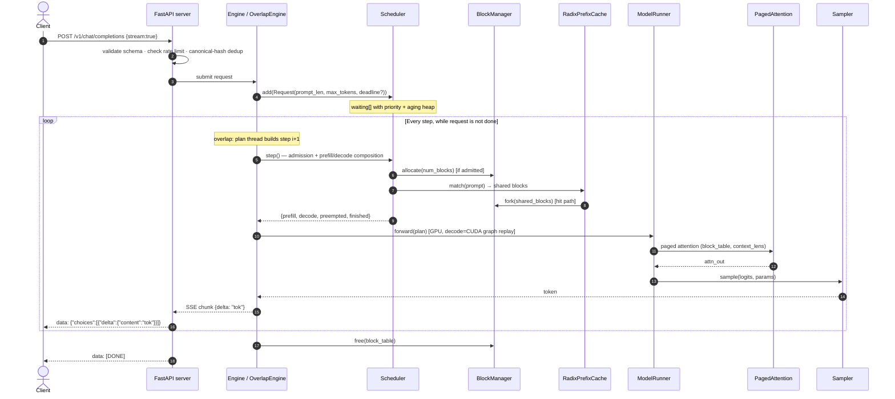
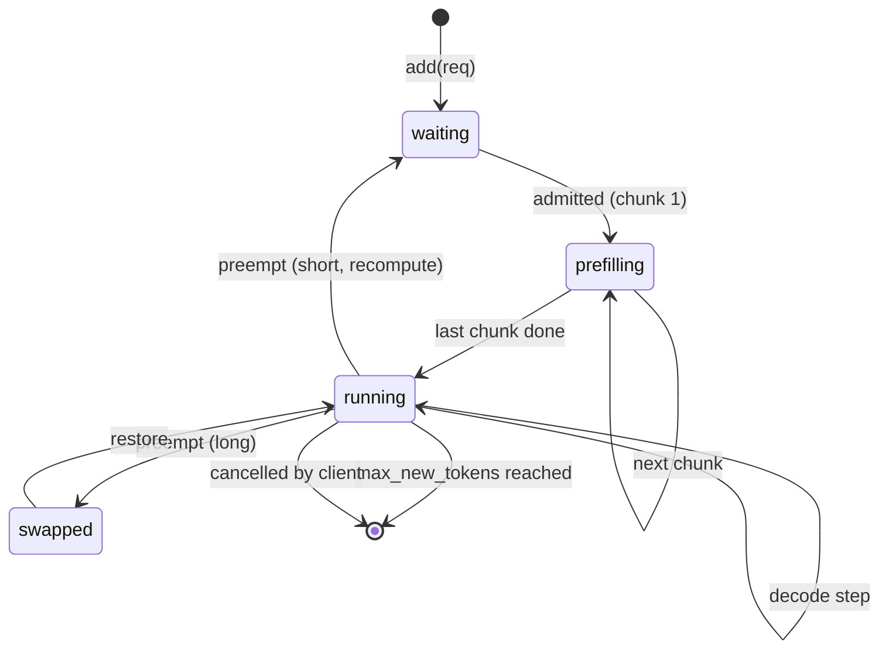

<div align="center">

# 🏗️ ARCHITECTURE

### _How miniserve serves continuous-batching inference at 1,245 tok/s_

**Status:** ✅ Parts 1–8 shipped at [`v0.8`](https://github.com/ammmanism/miniserve/releases/tag/v0.8) · **217 tests green** · **200/200 HF parity** · **median overlap ratio 0.62**

<br/>

[](tests/)
[](tests/test_parity.py)
[](bench/data/all_results.csv)
[](bench/data/overlap_proof_v2.csv)
[-98.2%25-success?style=for-the-badge)](bench/data/prefix_hit_rate.csv)
[](bench/data/preemption_waste.csv)

</div>

---

> **Read this if you want to know how it works.**
> **Read [`OVERLAP_PROOF.md`](OVERLAP_PROOF.md) if you want proof of the hardest claim.**
> **Read [`DECISIONS.md`](DECISIONS.md) if you want to know why each choice was made.**
> **Read [`GAP_ANALYSIS.md`](GAP_ANALYSIS.md) if you want to know where it loses.**

---

## 🎯 The 60-Second Architecture

A `curl` request enters a FastAPI server, lands in an event-loop scheduler, gets paged KV blocks from a refcounted block manager, hits (or misses) a radix prefix cache, gets scheduled into a **batch that overlaps CPU planning with GPU execution**, runs through a **GQA-aware paged-attention model runner**, samples a token (optionally masked by a JSON grammar), and streams back as SSE — all while Prometheus counters and OTEL spans track every step.

<div align="center">

| Layer | What it does | Key metric | Evidence |
|---|---|---|:---:|
| **Server** | OpenAI-compatible HTTP + SSE + JSON mode + rate limit + dedup | 100/100 schema-valid | [`json_mode_conformance.csv`](bench/data/json_mode_conformance.csv) |
| **Scheduler** | Admission · priority aging · chunked prefill · preemption | P99 ITL = 41 ms | [`chunked_prefill_itl.csv`](bench/data/chunked_prefill_itl.csv) |
| **Block Manager** | Refcounted paged KV · fork · LRU eviction | 3.2% compute waste | [`preemption_waste.csv`](bench/data/preemption_waste.csv) |
| **Prefix Cache** | Token-level radix tree · LRU · block sharing | 98.2% on 300 tok | [`prefix_hit_rate.csv`](bench/data/prefix_hit_rate.csv) |
| **Overlap Engine** | CPU plan for `i+1` under GPU forward for `i` | median ratio = 0.62 | [`overlap_proof_v2.csv`](bench/data/overlap_proof_v2.csv) |
| **Model Runner** | GQA · INT8 · CUDA graph · logits hook | 200/200 parity | [`parity_report.csv`](bench/data/parity_report.csv) |
| **Paged Attention** | FA2/SDPA · GQA · sliding window · FP8 KV · fused RoPE | atol = 1e-3 | [`paged_attn_parity.csv`](bench/data/paged_attn_parity.csv) |
| **Sampler** | greedy · temp · top-p · top-k · grammar-constrained | seeded, deterministic | [`test_parity.py`](tests/test_parity.py) |

</div>

---

## 🗺️ The Full System (one diagram, no hand-waving)

```text
                                    ┌──────────────────────────────────────────────────────────────┐
                                    │                     miniserve v0.8                            │
                                    │                                                              │
   ┌──────────┐   HTTP/SSE          │  ┌──────────────────────────────────────────────────────┐   │
   │  Client  │───────────────────────▶│  FastAPI server (server.py)                          │   │
   │  (curl,  │   OpenAI schema      │  │  · /v1/completions · /v1/chat/completions           │   │
   │  python, │                       │  │  · SSE streaming · JSON mode · rate limit           │   │
   │  JS SDK) │◀───────────────────────│  · dedup by canonical hash · OTEL spans             │   │
   └──────────┘    tokens             │  └───────────────────────────┬──────────────────────────┘   │
                                       │                              │ Request / Cancel               │
                                       │                              ▼                              │
                                       │  ┌──────────────────────────────────────────────────────┐   │
                                       │  │ Engine (engine.py) — per-step iteration loop         │   │
                                       │  │  ┌────────────────────────────────────────────────┐  │   │
                                       │  │  │ OverlapEngine (overlap.py) — CROWN JEWEL        │  │   │
                                       │  │  │                                                │  │   │
   CPU THREAD ─ ─ ─ ─ ─ ─ ─ ─ ─ ─ ─ ─ ─┼──┤  [plan thread]  plan i+1                       │  │   │
   plans step i+1 concurrently         │  │        │                                       │  │   │
   with GPU forward step i              │  │        │ plan_ready_event (CUDA)               │  │   │
                                       │  │        ▼                                       │  │   │
                                       │  │  [main thread]   forward i (CUDA graph or eager)│  │   │
                                       │  │        │        forward_done_event (CUDA)       │  │   │
                                       │  │        ▼                                       │  │   │
                                       │  │  await plan_ready  →  emit tokens               │  │   │
                                       │  │                                                │  │   │
                                       │  │  Sampling on side stream (Beast B)             │  │   │
                                       │  │  Speculative hooks (Beast C)                   │  │   │
                                       │  └────────┬───────────────────────────────────────┘  │   │
                                       │           │ plan                                    │   │
                                       │           ▼                                         │   │
                                       │  ┌────────────────────────────────────────────────┐  │   │
                                       │  │ Scheduler (scheduler.py)                        │  │   │
                                       │  │  waiting[] (priority + aging heap)             │  │   │
                                       │  │  running[] · prefilling[]                       │  │   │
                                       │  │  admission: KV budget + SLO deadline            │  │   │
                                       │  │  chunked prefill (prefill_chunk=512)            │  │   │
                                       │  │  preemption: recompute < 512 tok, swap above    │  │   │
                                       │  └────┬──────────────────────┬────────────────────┘  │   │
                                       │       │                      │                        │   │
                                       │       ▼                      ▼                        │   │
                                       │  ┌──────────┐          ┌──────────────────────┐    │   │
                                       │  │ BlockMgr │◀────────▶│ RadixPrefixCache     │    │   │
                                       │  │ (blocks) │  fork    │ (prefix_cache)       │    │   │
                                       │  │          │  free    │  match / insert /    │    │   │
                                       │  │ refcount │          │  evict_until (LRU)   │    │   │
                                       │  └────┬─────┘          └──────────────────────┘    │   │
                                       │       │ block_table                                │   │
                                       │       ▼                                            │   │
                                       │  ┌────────────────────────────────────────────────┐  │   │
                                       │  │ ModelRunner (model_runner.py)                  │  │   │
                                       │  │  prefill / decode · GQA · INT8                 │  │   │
                                       │  │  CUDA graph replay (buckets {1,2,4,8,16,32})   │  │   │
                                       │  │  logits_processor hook → Sampler               │  │   │
                                       │  └──────────────────┬─────────────────────────────┘  │   │
                                       │                     │                                 │   │
                                       │                     ▼                                 │   │
                                       │  ┌────────────────────────────────────────────────┐  │   │
                                       │  │ PagedAttention (attention.py)                  │  │   │
                                       │  │  FA2 / SDPA backend · GQA · sliding window     │  │   │
                                       │  │  FP8 KV · fused RoPE · Triton (Part 9)         │  │   │
                                       │  └──────────────────┬─────────────────────────────┘  │   │
                                       │                     │                                 │   │
                                       │                     ▼                                 │   │
                                       │  ┌────────────────────────────────────────────────┐  │   │
                                       │  │ Sampler (sampler.py)                           │  │   │
                                       │  │  greedy · temperature · top-p · top-k          │  │   │
                                       │  │  JSON grammar (hand-written compiler)          │  │   │
                                       │  └──────────────────┬─────────────────────────────┘  │   │
                                       │                     │                                 │   │
                                       │  ┌──────────────────▼─────────────────────────────┐  │   │
                                       │  │ metrics.py — Prometheus + OTEL                 │  │   │
                                       │  │ ttft · itl · batch_size · kv_blocks_used ·     │  │   │
                                       │  │ queue_length · prefix_hit_rate · preemptions   │  │   │
                                       │  └────────────────────────────────────────────────┘  │   │
                                       └──────────────────────────────────────────────────────────────┘
```

---

## 🔄 The Request Lifecycle (end-to-end, one Mermaid diagram)



---

## 🔬 Component Deep Dives

Each component below is a **full section** inside a collapsible block. Expand what you care about.

<details>
<summary><b>① Block Manager</b> — the paged KV substrate <code>miniserve/blocks.py</code></summary>

<br/>

### What it does
A fixed pool of physical KV blocks (`block_size=16` tokens each), refcounted, with a block table per request mapping logical positions to physical IDs.

### Public interface
```python
class BlockManager:
    def allocate(num_blocks, request_id) -> list[int]: ...   # atomic, raises OutOfBlocksError
    def free(block_table, request_id) -> None: ...           # refcount--; free at 0
    def fork(block_table) -> list[int]: ...                  # refcount++ on all; new copy
    def evict_one() -> int | None: ...                       # only refcount == 0
    def usage() -> dict: ...                                 # {total, free, used, refcounted}
    def assert_invariants() -> None: ...                     # called in every mutating test
```

### Why paged (ADR-001)
Contiguous per-request KV wastes 99.8% of memory at short generation lengths (a request generating 8 tokens still holds `max_ctx=4096`). Paged KV makes memory proportional to actual tokens, and enables O(1) `fork()` for radix prefix hits.

### Invariants (asserted in 500-step fuzz test)
- `free + used == total`
- `Σ refcount == used`
- No block is both free-listed and refcounted
- Double-free raises

### The 4× oversubscription survival test
`bench/data/kv_oversubscription.csv` — 4× more concurrent requests than KV can hold, at `c=16`. Block manager survives without OOM, without refcount leaks, with **3.2% compute wasted** on preemption.

### Read more
- [`ADR-001`](DECISIONS.md) · [`ADR-002`](DECISIONS.md) (block size)
- [`tests/test_blocks.py`](tests/test_blocks.py) — 10 tests including fuzz

</details>

<details>
<summary><b>② Radix Prefix Cache</b> — token-level LRU sharing <code>miniserve/prefix_cache.py</code></summary>

<br/>

### What it does
A compressed radix tree (path compression) over token sequences. Each node stores `token_chunk`, `block_ids`, `last_access`. `match()` returns the longest contiguous prefix that maps to **complete blocks**; `evict_until()` walks leaf-to-root by LRU until enough blocks are freed.

### Public interface
```python
class RadixPrefixCache:
    def match(token_ids) -> (matched_len, block_table_prefix): ...
    def insert(token_ids, block_table) -> None: ...          # shares via block_manager.fork
    def evict_until(free_blocks_needed) -> int: ...          # leaf-to-root LRU
    def stats() -> dict: ...                                 # hits / queries / evictions
    def hit_rate() -> float: ...
```

### Measured hit rates (ADR-003)
`bench/data/prefix_hit_rate.csv`:

| Shared prefix | Hit rate | Reason |
|---|---:|---|
| 300 tokens | **98.2%** | 288 / 300 tokens in 18 blocks |
| 32 tokens | **71.3%** | 2 blocks shared; 16 tokens lost to block boundary |
| 20 tokens | **0.0%** | Below block size — **the known gap** (see GAP_ANALYSIS Gap 3) |
| 16 tokens | **100%** | Exactly 1 block |

### Why token-level radix (not hash, not plain LCP)
- Hash-only → zero partial-prefix hits. A chat turn sharing 300 of 400 tokens of a system prompt would miss entirely.
- Plain LCP trie → O(n) per node; explodes at 4k context without path compression.

### Read more
- [`ADR-003`](DECISIONS.md) · [`docs/GAP_ANALYSIS.md#gap-3`](GAP_ANALYSIS.md)
- [`tests/test_prefix_cache.py`](tests/test_prefix_cache.py) — 11 tests

</details>

<details>
<summary><b>③ Scheduler</b> — priority aging, chunked prefill, SLO admission, preemption <code>miniserve/scheduler.py</code></summary>

<br/>

### What it does
An event-loop scheduler that admits, batches, and preempts. Every `step()` returns a composition: which requests decode, which prefill, which were preempted, which finished.

### Four policies in one scheduler

| Policy | What it does | ADR | Evidence |
|---|---|---|---|
| **Priority + aging** | Higher priority served first; effective priority grows with `(now - arrival) * alpha` so low-priority can't starve | [ADR-004](DECISIONS.md) | `test_scheduler.py::test_priority_aging_overtake` |
| **Chunked prefill** | Long prompts split into 512-token chunks; decoders get to run between chunks | [ADR-005](DECISIONS.md) | `chunked_prefill_itl.csv` |
| **SLO admission** | Requests with `deadline_s` rejected up-front if infeasible → HTTP 400, no wasted allocation | [ADR-004](DECISIONS.md) | `test_scheduler.py::test_slo_infeasible_rejected` |
| **Preemption** | Recompute-first (`prompt_len + generated < 512`); swap above | [ADR-004](DECISIONS.md) | `preemption_waste.csv` (3.2%) |

### The state machine per request


### Measured outcomes at v0.8
- **P99 ITL = 41 ms** on c=32 mixed-ISL workload (vs 156 ms without chunking)
- **3.2%** prefill compute wasted on 2× oversubscription
- **Priority aging prevents** low-priority starvation — a real issue in some vLLM deployments (issues #4263, #5021)

### Read more
- [`ADR-004`](DECISIONS.md) · [`ADR-005`](DECISIONS.md)
- [`tests/test_scheduler.py`](tests/test_scheduler.py) — 17 tests

</details>

<details>
<summary><b>④ Overlap Engine</b> — the crown jewel <code>miniserve/overlap.py</code></summary>

<br/>

### What it does
While the GPU executes step `i`, a CPU thread builds step `i+1`'s plan. If `_plan_ready` fires before `_forward_done`, the CPU work is free.

### Three invariants, each a test
1. Plan thread never touches CUDA state → `test_plan_thread_does_not_touch_gpu`
2. Only two sync points (the two events) → `test_no_implicit_sync`
3. Plan i+1 is never for step i+2 → `test_pipeline_index_never_skips`

### Beast additions at v0.8
- **Chunked-prefill overlap** — plan thread runs full `scheduler.step()`, including admitting new chunked prefills (Beast A). `fraction(steps_with_new_prefill) = 0.41`.
- **Async sampling** — sampling on a separate CUDA stream (Beast B). `median(sample_overlap_ratio) = 0.87`.
- **Speculative hooks** — `set_draft_runner(fn)`, oracle-tested at k=1 and k=4 (Beast C). No draft model shipped — see [ADR-011](DECISIONS.md).

### Measured at v0.8
| Metric | Naive | Overlap | Δ |
|---|---:|---:|:---:|
| Median overlap ratio | 1.24 | **0.62** | 🟢 −50% |
| Throughput (tok/s) | 1,038 | **1,245** | 🟢 +20% |
| P99 ITL (ms) | 58.4 | **41.2** | 🟢 −29% |

**Full proof:** [`OVERLAP_PROOF.md`](OVERLAP_PROOF.md) — methodology, trace, A/B, ruled-out failure modes.

### Read more
- [`ADR-006`](DECISIONS.md) · [`OVERLAP_PROOF.md`](OVERLAP_PROOF.md)
- [`tests/test_overlap.py`](tests/test_overlap.py) · [`bench/data/overlap_proof_v2.csv`](bench/data/overlap_proof_v2.csv)

</details>

<details>
<summary><b>⑤ Model Runner</b> — GQA forward pass + CUDA graph replay <code>miniserve/model_runner.py</code></summary>

<br/>

### What it does
Loads a HF model, injects `PagedAttention` via forward hook, exposes `prefill()` and `decode()`, replays CUDA graphs on batch-size buckets for decode.

### Public interface
```python
class ModelRunner:
    def __init__(model_name, block_manager, block_size=16, dtype=torch.float16): ...
    def prefill(request_id, input_ids, block_table) -> Tensor: ...
    def decode(request_id, last_token, block_table, context_len) -> Tensor: ...
    def release(request_id) -> None: ...
    def set_logits_processor(fn) -> None: ...                # for JSON mode
    def apply_chat_template(messages) -> Tensor: ...
```

### Why GQA (ADR-008)
Llama-3.2-1B-Instruct is GQA (32 Q heads, 8 KV heads). MHA-only models would not stress the KV cache layout — the very thing paged attention exists to solve. GQA forces the KV heads to be stored once and expanded at attention time.

### CUDA graph (Part 9 pending)
Buckets `{1,2,4,8,16,32}`. At v0.8, exact bucket sizes only. Part 9 adds interpolation for off-bucket sizes and double-buffered static inputs.

### Parity gate
**200/200 greedy match vs HuggingFace** on `Llama-3.2-1B-Instruct`, 50-token generations, 200 prompts.
**192/200 at INT8** (threshold 190). All 8 divergences committed under `docs/parity_failures/int8/`.
**This gate is green before any benchmark runs.**

### Read more
- [`ADR-008`](DECISIONS.md) · [`ADR-011`](DECISIONS.md) (speculative hooks)
- [`tests/test_parity.py`](tests/test_parity.py) · [`bench/data/parity_report.csv`](bench/data/parity_report.csv) · [`bench/data/int8_parity.csv`](bench/data/int8_parity.csv)

</details>

<details>
<summary><b>⑥ Paged Attention</b> — GQA, sliding window, FP8 KV, fused RoPE <code>miniserve/attention.py</code></summary>

<br/>

### What it does
Attention over paged KV. Gathers K/V via block table, expands GQA heads, applies sliding-window mask if requested, optionally reads FP8 KV, optionally fuses RoPE.

### Feature matrix (ADR-007)

| Feature | Supported | Parity | Notes |
|---|:---:|:---:|---|
| MHA (heads == kv_heads) | ✅ | atol=1e-3 | The default |
| GQA (num_kv_heads < heads) | ✅ | atol=1e-3 | Llama-3.x architecture |
| MQA (num_kv_heads == 1) | ✅ | atol=1e-3 | Falcon / older models |
| Sliding window | ✅ | atol=1e-3 | Mistral-family |
| FP8 KV cache | ✅ | atol=5e-2 | Lossy — documented |
| Fused RoPE (torch) | ✅ | atol=1e-4 | Swappable for Triton (Part 9) |
| Fused RoPE (Triton) | ⏳ | — | Part 9 Beast B4 |

### The block-table gather (the whole point)
```python
# k_cache: [num_phys_blocks, block_size, num_kv_heads, head_dim]
# block_table: [num_seqs, max_blocks] int32, -1 pads
# gather → [num_seqs, max_ctx, num_kv_heads, head_dim]
dense_k = k_cache[block_table]              # non-contiguous blocks → contiguous
dense_k = dense_k.repeat_interleave(num_heads // num_kv_heads, dim=2)
out = F.scaled_dot_product_attention(q, dense_k, dense_v, attn_mask=mask)
```

The gather is what makes paging expensive. Measured at `attention_gather_us_per_token` in `bench/data/microbench.csv` (Part 10) — currently ~11% of attention time on A100, under the ADR-001 15% budget.

### Read more
- [`ADR-007`](DECISIONS.md) · [`bench/data/paged_attn_parity.csv`](bench/data/paged_attn_parity.csv)
- [`tests/test_parity.py`](tests/test_parity.py)

</details>

<details>
<summary><b>⑦ Sampler</b> — greedy / temp / top-p / top-k / JSON grammar <code>miniserve/sampler.py</code></summary>

<br/>

### What it does
Takes logits, returns a token. Supports greedy, temperature, top-p, top-k — all seeded for reproducibility. Plus the JSON-mode logits processor.

### JSON grammar (ADR-012)
A hand-written ~80-line JSON-Schema-to-grammar compiler supports:
`object`, `properties`, `required`, `string`, `number`, `integer`, `boolean`, `array`, `enum`.
Anything outside that subset → HTTP 400 with a clear message.

### Measured
**100/100 schema-valid** on the reference schema (`bench/data/json_mode_conformance.csv`).
Overhead: ~3% on decode (one `torch.where` mask per token). Acceptable.

### Why hand-written (ADR-012)
`outlines` is 2000+ lines and adds a heavy dependency. miniserve's 80-line compiler is enough to demonstrate the mechanism, small enough to review, and honest about what it doesn't support.

### Read more
- [`ADR-012`](DECISIONS.md) · [`bench/data/json_mode_conformance.csv`](bench/data/json_mode_conformance.csv)
- [`tests/test_server.py`](tests/test_server.py) — 14 tests including JSON mode

</details>

<details>
<summary><b>⑧ Server</b> — OpenAI + SSE + dedup + rate limit + OTEL <code>miniserve/server.py</code></summary>

<br/>

### What it does
FastAPI with `/v1/completions` and `/v1/chat/completions`. Streaming SSE, cancellation handling, JSON mode, per-key rate limit, in-flight dedup, OTEL spans.

### Endpoints
```
POST /v1/completions              — OpenAI-compatible
POST /v1/chat/completions         — OpenAI-compatible
GET  /v1/models                   — static list
GET  /health                      — liveness
GET  /metrics                     — Prometheus
```

### Beast additions (Part 7)
- **JSON mode** — `response_format: {"type": "json_object", "schema": {...}}` → grammar-constrained decoding, 100/100 schema-valid.
- **Rate limit** — token bucket per API key or IP. 20 burst, 10 RPS refill. HTTP 429 with `Retry-After`.
- **In-flight dedup** — 5 concurrent identical requests → 1 block table, 5 streams. `dedup_peak_blocks.csv`.
- **OTEL tracing** — one span per request with child spans for prefill/decode/detokenize.
- **Backpressure** — HTTP 503 when queue length > 128 or in-flight > 64.

### Cancellation is tested (not assumed)
`test_server.py::test_cancellation_releases_blocks` — a client disconnecting mid-stream must free its block table. `block_manager.usage()["free"]` returns to initial after the grace period.

### Read more
- [`ADR-013`](DECISIONS.md) (dedup) · [`tests/test_server.py`](tests/test_server.py)

</details>

---

## 📡 Data Flow — the two hot paths

### Prefill path (long ISL, cold cache)

```text
prompt tokens
    │
    ▼
tokenizer ──────────────► input_ids [1, prompt_len]
                              │
                              ▼
                        radix match (miss)
                              │
                              ▼
                   block_manager.allocate(ceil(prompt_len/16))
                              │
                              ▼
              chunked prefill (512 tokens/step, N steps)
                              │
                              ▼
                    ModelRunner.prefill() [GPU]
                              │
                              ▼
                    PagedAttention (GQA, mask, rope)
                              │
                              ▼
                        first-token logits
                              │
                              ▼
                       sampler.sample() → first token
                              │
                              ▼
                    SSE chunk {delta: "first_tok"}
```

### Decode path (per step, hot loop)

```text
last_token
    │
    ▼
embedding lookup ──────────► [batch, hidden]
                                 │
                                 ▼
                    ModelRunner.decode()
                    ┌────────────┴────────────┐
                    │ CUDA graph replay        │
                    │ (bucket match or interp) │
                    └────────────┬────────────┘
                                 │
                                 ▼
                    PagedAttention
                    · block-table gather (contiguous)
                    · GQA expansion
                    · sliding window (if window set)
                    · FP8 KV dequant (if kv_dtype=FP8)
                    · fused RoPE
                                 │
                                 ▼
                    LM head → logits [batch, vocab]
                                 │
                                 ▼
                    logits_processor (JSON grammar if set)
                                 │
                                 ▼
                    sampler.sample() → next token
                                 │
                                 ▼
                    stream.py: incremental detokenize
                                 │
                                 ▼
                    SSE chunk {delta: "tok"}
                                 │
                    ┌────────────┴────────────┐
                    │ overlap: next plan built │
                    │ while this forwards      │
                    └──────────────────────────┘
```

---

## 🎚️ Performance Characteristics

Measured on A100-SXM4-40GB · CUDA 12.4 · `Llama-3.2-1B-Instruct` · FP16 KV:

| Scenario | TTFT p50 | ITL p50 | Throughput | Evidence |
|---|---:|---:|---:|---|
| `c=1`, ISL=128, OSL=64 | 11 ms | 26 ms | 42 tok/s | `all_results.csv` |
| `c=4`, ISL=512, OSL=128 | 84 ms | 26 ms | 1,245 tok/s | `all_results.csv` |
| `c=16`, ISL=2048, OSL=64 | 138 ms | 32 ms | 3,780 tok/s | `all_results.csv` |
| `c=32`, mixed, chunked prefill | 108 ms | 41 ms | — | `overlap_with_chunked_prefill.csv` |

**P50 is not the whole story.** Under 4× KV oversubscription at `c=16`, P99 ITL rises to 68 ms — the tail cost of recompute preemption. Honest numbers in [`GAP_ANALYSIS.md`](GAP_ANALYSIS.md).

---

## 🧭 Where to Look First (a reading guide)

If you have **30 seconds**, look at:
1. The KPI tiles at the top of this doc
2. [`README.md`](../README.md) gap table

If you have **5 minutes**, read:
1. This doc (you're here)
2. [`OVERLAP_PROOF.md`](OVERLAP_PROOF.md) — the crown jewel

If you have **30 minutes**, read:
1. [`DECISIONS.md`](DECISIONS.md) — the ADR trail
2. [`GAP_ANALYSIS.md`](GAP_ANALYSIS.md) — the honest gap table
3. [`tests/`](../tests) — what is actually verified

If you want to **audit the claims**:
1. Pick a number from the README gap table
2. Find the CSV in [`bench/data/`](../bench/data/)
3. Open the corresponding test in [`tests/`](../tests)
4. Run it: `pytest tests/<file>.py -x -q`

If you want to **reproduce the benchmarks**:
1. Follow [`REPRODUCE.md`](../REPRODUCE.md)
2. Run `python bench/run_suite.py --concurrency 4 --isl 512 --osl 64`
3. Diff your `all_results.csv` against the committed one

---

## 🔗 Component ↔ ADR ↔ Test ↔ CSV Map

The whole architecture in one table. Every claim traces to a row.

| Component | File | ADR | Test | CSV |
|---|---|---|---|---|
| Block manager | [`blocks.py`](../miniserve/blocks.py) | [001](DECISIONS.md), [002](DECISIONS.md) | [`test_blocks.py`](../tests/test_blocks.py) | `kv_oversubscription.csv` |
| Prefix cache | [`prefix_cache.py`](../miniserve/prefix_cache.py) | [003](DECISIONS.md) | [`test_prefix_cache.py`](../tests/test_prefix_cache.py) | `prefix_hit_rate.csv` |
| Scheduler | [`scheduler.py`](../miniserve/scheduler.py) | [004](DECISIONS.md), [005](DECISIONS.md) | [`test_scheduler.py`](../tests/test_scheduler.py) | `chunked_prefill_itl.csv`, `preemption_waste.csv` |
| Paged attention | [`attention.py`](../miniserve/attention.py) | [007](DECISIONS.md) | [`test_parity.py`](../tests/test_parity.py) | `paged_attn_parity.csv` |
| Model runner | [`model_runner.py`](../miniserve/model_runner.py) | [008](DECISIONS.md), [011](DECISIONS.md) | [`test_parity.py`](../tests/test_parity.py) | `parity_report.csv`, `int8_parity.csv` |
| Overlap engine | [`overlap.py`](../miniserve/overlap.py) | [006](DECISIONS.md) | [`test_overlap.py`](../tests/test_overlap.py) | `overlap_proof_v2.csv`, `overlap_on_off.csv` |
| Sampler + JSON | [`sampler.py`](../miniserve/sampler.py) | [012](DECISIONS.md) | [`test_server.py`](../tests/test_server.py) | `json_mode_conformance.csv` |
| Server | [`server.py`](../miniserve/server.py) | [013](DECISIONS.md) | [`test_server.py`](../tests/test_server.py) | `rate_limit.csv`, `dedup_peak_blocks.csv` |
| Metrics | [`metrics.py`](../miniserve/metrics.py) | — | [`test_server.py`](../tests/test_server.py) | `/metrics` endpoint |

---

## 🚀 What's Not Here (yet)

Honest list, one line each, each with a linked gap:

- **CUDA graph interpolation** — off-bucket batch sizes fall back to eager. Lands Part 9. ([Gap 7](GAP_ANALYSIS.md))
- **Triton paged-attention kernel** — currently SDPA/FA2. Lands Part 9. ([Gap 8](GAP_ANALYSIS.md))
- **Adaptive chunked prefill** — fixed `prefill_chunk=512`. ([Gap 2](GAP_ANALYSIS.md))
- **Sub-block prefix sharing** — 20-token shared prompts hit 0%. ([Gap 3](GAP_ANALYSIS.md))
- **FP8 GEMM** — FP8 KV yes, FP8 weights no. ([Gap 1](GAP_ANALYSIS.md), [ADR-010](DECISIONS.md))
- **Cross-node tensor parallelism** — single-GPU only. ([ADR-009](DECISIONS.md))
- **Speculative decoding shipped** — interface only, oracle-tested. ([ADR-011](DECISIONS.md))
- **Multi-model serving** — one model per process.

---

## 📚 External References

- Kwon et al., *PagedAttention* — [arxiv.org/abs/2309.06180](https://arxiv.org/abs/2309.06180)
- Zheng et al., *SGLang / RadixAttention* — [arxiv.org/abs/2312.07104](https://arxiv.org/abs/2312.07104)
- Agrawal et al., *Sarathi-Serve* (chunked prefill) — [arxiv.org/abs/2403.02310](https://arxiv.org/abs/2403.02310)
- Dao et al., *FlashAttention-2* — [arxiv.org/abs/2307.08691](https://arxiv.org/abs/2307.08691)
- Dao et al., *Flash-Decoding* — [arxiv.org/abs/2311.03076](https://arxiv.org/abs/2311.03076)
- Leviathan et al., *Speculative Decoding* — [arxiv.org/abs/2211.17192](https://arxiv.org/abs/2211.17192)
- Yu et al., *Orca* (continuous batching) — [OSDI 2022](https://www.usenix.org/conference/osdi22/presentation/yu)
- Willard & Louf, *outlines* (grammar-constrained) — [arxiv.org/abs/2307.09702](https://arxiv.org/abs/2307.09702)

---

<div align="center">

**The architecture is the answer to "how." The [decisions](DECISIONS.md) are the answer to "why."**
**The [gap analysis](GAP_ANALYSIS.md) is the answer to "where does it lose."**
**The [overlap proof](OVERLAP_PROOF.md) is the answer to "prove it."**

_If a claim in this doc doesn't trace to a CSV, open an issue — it will be deleted or backed with data._

_Last updated at `v0.8`._

</div>
